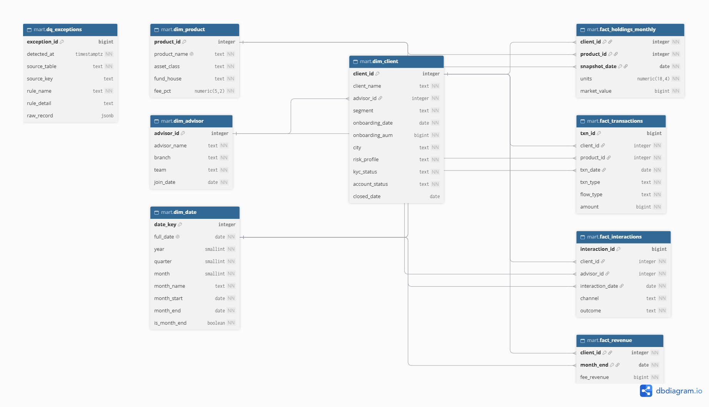
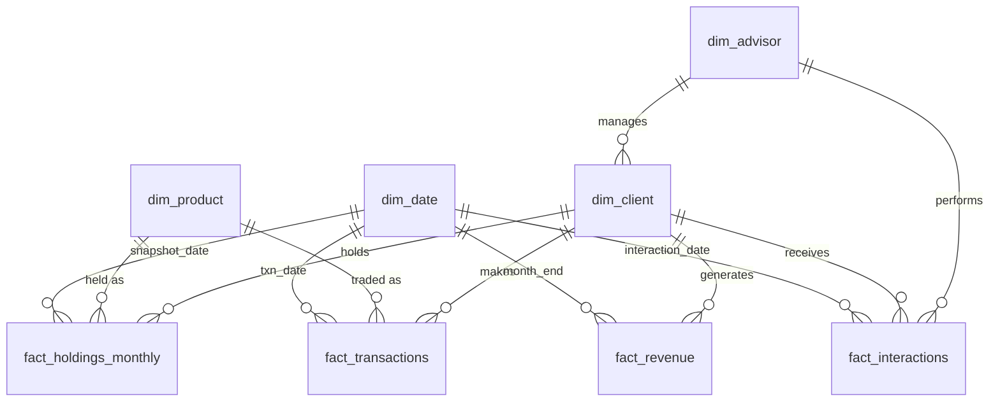

# Data model

The mart is a star schema: four dimensions (`dim_client`, `dim_advisor`, `dim_product`, `dim_date`) and four facts (`fact_holdings_monthly`, `fact_transactions`, `fact_interactions`, `fact_revenue`). A fifth table, `dq_exceptions`, is the audit log of every row the ETL rejected or repaired. Constraints enforce the KPI dictionary rules (segment bands, status/closed-date consistency, transaction type and flow type pairing, month-end snapshots).

The same diagram as Mermaid (source: [er_diagram.mmd](er_diagram.mmd); DBML: [er_diagram.dbml](er_diagram.dbml)):

## Schemas

| Schema | Purpose |
|---|---|
| `staging` | Raw loads with no constraints. Dirty rows are allowed to land here. Never modified after loading. |
| `mart` | Clean, validated tables. Written only by the ETL (`sql/etl/`). |
| `analytics` | Read-only views over the mart (`sql/analytics/`), one documented file per view. No stored data. |

## Grain of each table

| Table | One row per |
|---|---|
| `dim_client` | client (segment fixed at onboarding) |
| `dim_advisor` | advisor |
| `dim_product` | investable product (fund, bond, gold, cash vehicle) |
| `dim_date` | calendar day, 2024-01-01 to 2027-12-31 (1,461 rows) |
| `fact_holdings_monthly` | client x product x month-end snapshot |
| `fact_transactions` | transaction (`flow_type` separates external flows from internal switches) |
| `fact_interactions` | advisor-client interaction (only `connected` counts for contact gap) |
| `fact_revenue` | client x month-end |
| `dq_exceptions` | rejected or remediated source row per failed rule |

Full column definitions are in `sql/schema/03_mart_tables.sql`; business rules are in the [KPI dictionary](kpi_dictionary.md).
